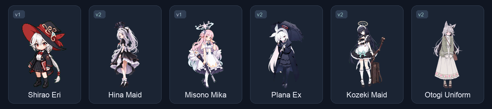

<h1 align="center">Codex Pets</h1>

<p align="center"><strong>Animated companions for your desktop.</strong><br>A fan-made collection of character pets for Codex.</p>

<p align="center"><strong>English</strong> · <a href="README.zh-CN.md">简体中文</a></p>

<p align="center">
  
  
  
</p>

<p align="center">
  <a href="#collection"><strong>Explore the collection</strong></a> ·
  <a href="#quick-start">Quick start</a> ·
  <a href="#package-format">Package format</a> ·
  <a href="https://github.com/MarkYang44/codex-pet/issues">Report an issue</a>
</p>

## Preview



[Shirao Eri](shirao-eri/) · [Hina Maid](hina-maid/) · [Misono Mika](misono-mika/) · [Plana Ex](plana-ex/) · [Kozeki Maid](kozeki-maid/) · [Otogi Uniform](otogi-uniform/)

These loops use actual idle frames from the included sprite sheets, with presentation timing. [Preview details](docs/images/README.md).

## Overview

Choose a character, copy its folder, and select it in Codex. Each package includes metadata, a transparent WebP sprite sheet, and its own installation notes. No build step is needed for the pet assets.

- **82 ready-to-copy packages**, from pixel-art characters to illustrated companions.
- **Both atlas generations preserved:** 70 v1 packages and 12 v2 packages, each with an explicit version marker.
- **Consistent packaging:** the same metadata fields and file layout throughout the collection.

## Quick start

Requires a Codex desktop build that supports custom pet packages. The app provides animation playback and pet selection.

1. [Download the repository ZIP](https://github.com/MarkYang44/codex-pet/archive/refs/heads/main.zip) and extract it, or clone the repository.
2. Choose a pet from the [collection](#collection) and copy its **entire folder** into your Codex pets directory. Create the directory if needed.

   | System | Default pets directory |
   | --- | --- |
   | macOS | `~/.codex/pets/` |
   | Windows | `%USERPROFILE%\.codex\pets\` |

3. Keep `pet.json` and `spritesheet.webp` together, one level below the pets directory. For example:

   ```text
   .codex/pets/plana-ex/
   ├── README.md
   ├── pet.json
   └── spritesheet.webp
   ```

4. Reopen Codex, then select the pet by its display name, such as **Plana Ex**.

Copy the character folder, rather than the outer `codex-pet-main` folder. Back up an existing folder before replacing it. If a pet does not appear, check the nesting above and confirm your app supports its atlas version.

## Collection

**82 packages · 70 v1 · 12 v2.** Open a name for that pet's files and README. Folder names distinguish outfit and character variants.

<details>
<summary><strong>Browse all 82 pets · alphabetical index</strong></summary>

| Pet | Folder | Atlas |
| --- | --- | --- |
| [Aikiyo Fuka](aikiyo-fuka/) | `aikiyo-fuka` | v1 |
| [Akeboshi Himari](akeboshi-himari/) | `akeboshi-himari` | v1 |
| [AL-1S Armed](al-1s-armed/) | `al-1s-armed` | v1 |
| [AL-1S Maid](al-1s-maid/) | `al-1s-maid` | v1 |
| [AL-1S Winter](al-1s-winter/) | `al-1s-winter` | v1 |
| [Arona](arona-v1/) | `arona-v1` | v1 |
| [Asuma Toki](asuma-toki/) | `asuma-toki` | v1 |
| [Azusa](azusa/) | `azusa` | v1 |
| [Hakari Atsuko](hakari-atsuko/) | `hakari-atsuko` | v1 |
| [Hina Kimono](hina-kimono/) | `hina-kimono` | v2 |
| [Hina Maid](hina-maid/) | `hina-maid` | v2 |
| [Hina Pajama](hina-pajama/) | `hina-pajama` | v1 |
| [Hina Uniform](hina-uniform/) | `hina-uniform` | v1 |
| [Hoshino Hanfu](hoshino-hanfu/) | `hoshino-hanfu` | v2 |
| [Hoshino Junior](hoshino-junior/) | `hoshino-junior` | v1 |
| [Igusa Haruka](igusa-haruka/) | `igusa-haruka` | v1 |
| [Itagaki Kanoe](itagaki-kanoe/) | `itagaki-kanoe` | v1 |
| [Kadenokoji Yukari](kadenokoji-yukari/) | `kadenokoji-yukari` | v1 |
| [Kasuga Tsubaki](kasuga-tsubaki/) | `kasuga-tsubaki` | v1 |
| [Kei](kei/) | `kei` | v1 |
| [Kei Anothermaid](kei-anothermaid/) | `kei-anothermaid` | v1 |
| [Kei Maid](kei-maid/) | `kei-maid` | v1 |
| [Kinui Rena](kinui-rena/) | `kinui-rena` | v1 |
| [Kirifuji Nagisa](kirifuji-nagisa/) | `kirifuji-nagisa` | v1 |
| [Kiryu Kikyo](kiryu-kikyo/) | `kiryu-kikyo` | v1 |
| [Kisaki Swimsuit](kisaki-swimsuit/) | `kisaki-swimsuit` | v1 |
| [Kiyosumi Akira](kiyosumi-akira/) | `kiyosumi-akira` | v1 |
| [Kozeki Maid](kozeki-maid/) | `kozeki-maid` | v2 |
| [Kuromi Serika](kuromi-serika/) | `kuromi-serika` | v1 |
| [Kurosaki Koyuki](kurosaki-koyuki/) | `kurosaki-koyuki` | v1 |
| [Kurumi JK](kurumi-jk/) | `kurumi-jk` | v1 |
| [Kurumi Maid](kurumi-maid/) | `kurumi-maid` | v1 |
| [Kurumi Uniform](kurumi-uniform/) | `kurumi-uniform` | v1 |
| [Kyoyama Kazusa](kyoyama-kazusa/) | `kyoyama-kazusa` | v1 |
| [Mari Gym](mari-gym/) | `mari-gym` | v1 |
| [Mari Maid](mari-maid/) | `mari-maid` | v2 |
| [Mayoi Shigure](mayoi-shigure/) | `mayoi-shigure` | v1 |
| [Miko Serika](miko-serika/) | `miko-serika` | v1 |
| [Misaka Mikoto](misaka-mikoto/) | `misaka-mikoto` | v1 |
| [Misono Mika](misono-mika/) | `misono-mika` | v1 |
| [Mitsuki Robe](mitsuki-robe/) | `mitsuki-robe` | v1 |
| [Miyoshi Takane](miyoshi-takane/) | `miyoshi-takane` | v1 |
| [Morizuki Suzumi](morizuki-suzumi/) | `morizuki-suzumi` | v1 |
| [Nagisa Maid](nagisa-maid/) | `nagisa-maid` | v2 |
| [Neuro-sama](neuro-sama/) | `neuro-sama` | v1 |
| [Niko Delivery](niko-delivery/) | `niko-delivery` | v1 |
| [Niko JK](niko-jk/) | `niko-jk` | v1 |
| [Niko Maid (pt.2)](niko-maid-pt-2/) | `niko-maid-pt-2` | v2 |
| [Niyaniya Maid](niyaniya-maid/) | `niyaniya-maid` | v1 |
| [Niyaniya Uniform](niyaniya-uniform/) | `niyaniya-uniform` | v2 |
| [Otogi Maid](otogi-maid/) | `otogi-maid` | v1 |
| [Otogi Maid (pt.2)](otogi-maid-pt-2/) | `otogi-maid-pt-2` | v2 |
| [Otogi Uniform](otogi-uniform/) | `otogi-uniform` | v2 |
| [Plana](plana/) | `plana` | v1 |
| [Plana Ex](plana-ex/) | `plana-ex` | v2 |
| [President(?)](president/) | `president` | v1 |
| [Prof Niyaniya](prof-niyaniya/) | `prof-niyaniya` | v1 |
| [Professor Maid](professor-maid/) | `professor-maid` | v1 |
| [Sakurai Miyo](sakurai-miyo/) | `sakurai-miyo` | v1 |
| [Seia](seia/) | `seia` | v1 |
| [Seia Maid](seia-maid/) | `seia-maid` | v2 |
| [Serika Idol](serika-idol/) | `serika-idol` | v1 |
| [Sexy Seia](sexy-seia/) | `sexy-seia` | v1 |
| [Shichido Yukino](shichido-yukino/) | `shichido-yukino` | v1 |
| [Shiranui Kaya](shiranui-kaya/) | `shiranui-kaya` | v1 |
| [Shirao Eri](shirao-eri/) | `shirao-eri` | v1 |
| [Shiroko](shiroko/) | `shiroko` | v1 |
| [Sorasaki Hina](sorasaki-hina/) | `sorasaki-hina` | v1 |
| [Sumi Serina](sumi-serina/) | `sumi-serina` | v1 |
| [Tachibana Nozomi](tachibana-nozomi/) | `tachibana-nozomi` | v1 |
| [Takakura Kurumi](takakura-kurumi/) | `takakura-kurumi` | v1 |
| [Takanashi Hoshino](takanashi-hoshino/) | `takanashi-hoshino` | v1 |
| [Tendo AL-1S](tendo-al-1s/) | `tendo-al-1s` | v1 |
| [Tenjinyama Otogi](tenjinyama-otogi/) | `tenjinyama-otogi` | v1 |
| [Tsukiyuki Miyako](tsukiyuki-miyako/) | `tsukiyuki-miyako` | v1 |
| [Kozeki Ui](ui/) | `ui` | v1 |
| [UZ Queen](uz-queen/) | `uz-queen` | v1 |
| [Uzawa Reisa](uzawa-reisa/) | `uzawa-reisa` | v1 |
| [Yoshino Niko](yoshino-niko/) | `yoshino-niko` | v1 |
| [Yukino Maid](yukino-maid/) | `yukino-maid` | v1 |
| [Yuuka Pajama](yuuka-pajama/) | `yuuka-pajama` | v1 |
| [Yuzu Maid](yuzu-maid/) | `yuzu-maid` | v1 |

</details>

## Package format

```text
<pet-folder>/
├── README.md          # Character notes, installation, and credits
├── pet.json           # Metadata and atlas version
├── spritesheet.webp   # Transparent animation atlas
└── preview.png        # Optional preview; present in some packages
```

`pet.json` uses UTF-8, two-space indentation, a final newline, and the field order below. This is the metadata from [Plana Ex](plana-ex/pet.json):

```json
{
  "id": "plana-ex",
  "displayName": "Plana Ex",
  "description": "A petite white-haired anime girl with a dark navy raincoat, lace-edged black parasol, pink halo, and white ribbon, preserving the supplied reference pose and proportions.",
  "spriteVersionNumber": 2,
  "spritesheetPath": "spritesheet.webp",
  "kind": "person"
}
```

| Atlas | Dimensions | Packages |
| --- | --- | --- |
| v1 | 1536 × 1872 | 70 |
| v2 | 1536 × 2288 | 12 |

Keep the version matched to the actual atlas layout. `spritesheetPath` is the relative filename `spritesheet.webp`; `kind` is `person` or `animal`. Existing IDs stay stable and may differ from their folder names.

## Contributing

For a new pet, use a unique folder, include its README, and follow the package format above. Check the ID, version, dimensions, transparency, and image decoding before submitting a pull request. Keep generation workspaces, validation reports, temporary files, and duplicate archives out of the collection.

For a broken package, [open an issue](https://github.com/MarkYang44/codex-pet/issues) with the pet folder, your app version, and what happened.

## Credits and usage

An unofficial fan-made collection for personal learning, showcase, and noncommercial sharing. Character names, artwork, and related rights belong to their respective owners. This project is not affiliated with or endorsed by OpenAI or the original rights holders. The repository does not provide a blanket license for third-party characters or artwork.

<p align="center">Curated by <a href="https://github.com/MarkYang44">Mark Yang</a></p>
